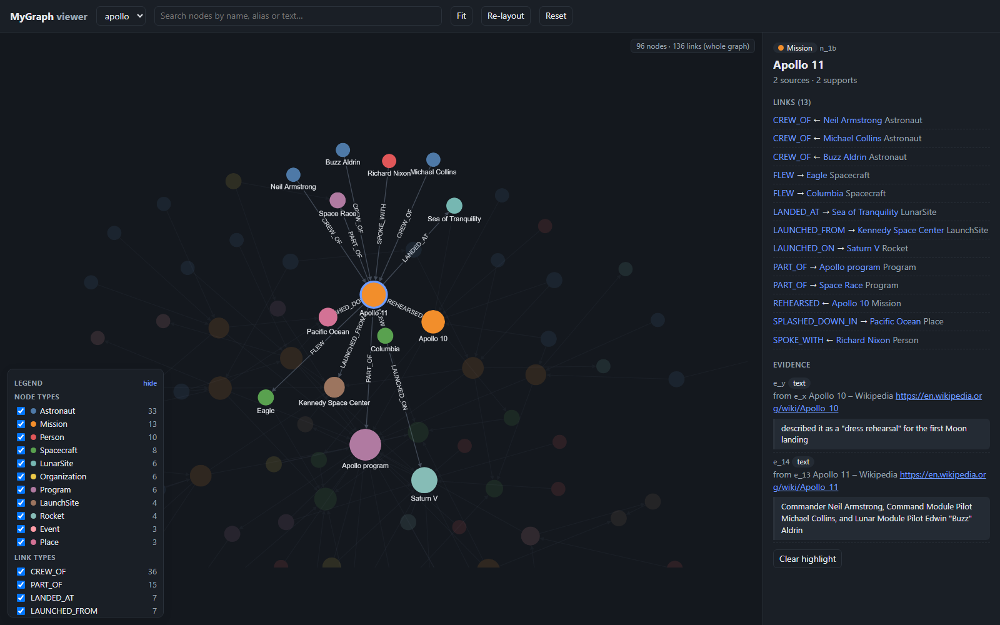
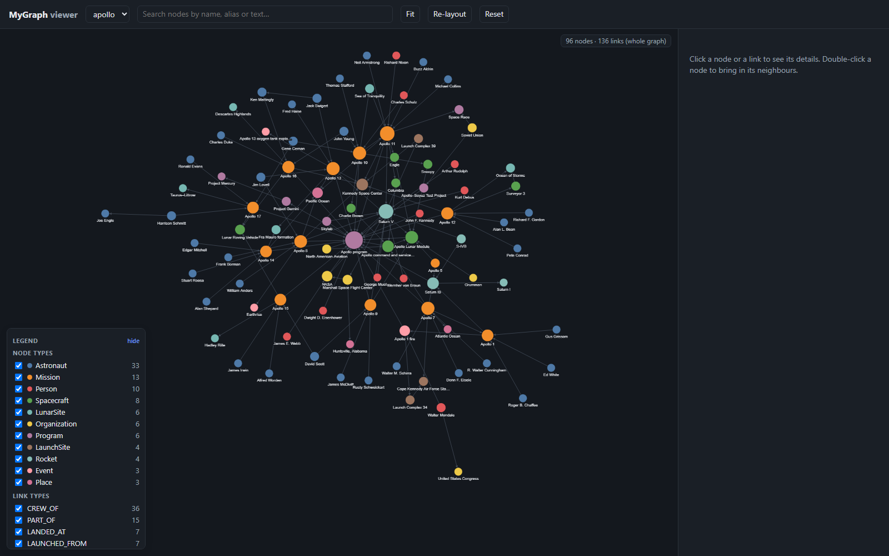

# MyGraph

**Built by AI, for AI.** A knowledge graph that AI agents use as their long-term memory, where
every fact points to the source it came from.

MyGraph was designed and written by AI coding agents (Claude, in Claude Code), with a human
setting the goals and making the decisions. Its users are agents too: they read and write it
through [MCP](https://modelcontextprotocol.io) tools shaped for how agents work, not through a
query language made for people. Humans install it, connect their agents, and look at what the
agents have built (a stats page and a graph viewer).

https://github.com/user-attachments/assets/3b7d85ee-d0f1-41d4-af67-b6ff04e8412a

*One agent records two Wikipedia articles; a second agent that never saw them answers from the
graph and quotes the sentences; the viewer shows the source behind a link.
Also [on YouTube](https://youtu.be/oXssE5qTpYA).*



*A graph of the Apollo missions, built from 17 Wikipedia articles ([examples/apollo](examples/apollo/build.py)).
Apollo 11 is selected; the panel lists its links and the sentences they were read from.*

## Why an agent would want it

- **Every fact cites its evidence.** A node, a link or a single property is backed by a source:
  a URL, a verbatim sentence, a document, a file, or the agent's own observation. By default a write
  without a citation is refused, so an answer can always be traced back and checked.
- **Tools made for agents.** 13 MCP tools and no query language. One `write` records a whole
  source (evidence, nodes, links, citations) atomically; `resolve` checks 100 names at once
  before writing, so agents don't create duplicates; results are compact text that costs few
  tokens; every error comes with a hint saying what to do next; writes are idempotent, so
  retrying is safe.
- **Search by words and by meaning.** Full-text search with stemming, plus semantic search
  with a small multilingual embedding model that runs locally, so a question in Ukrainian finds an
  English source. No calls to an outside API.
- **Nothing is deleted.** Wrong facts are retracted (and can be restored), duplicates are merged,
  and `history` shows every change, so an agent's mistakes can be undone.
- **One small server.** A single Rust binary keeps the graph and its indexes in memory and stores
  everything in SQLite. It runs on a laptop or a home server, with several graphs per server.
- **Your graphs stay on your machine.** Agents on your computer connect to it directly. Cloud AI
  (claude.ai on the web and phone, the Claude API, the OpenAI API) connects to your server over
  HTTPS, with a key that you limit to the graphs it may use
  ([Using your graphs from cloud AI](#using-your-graphs-from-cloud-ai)).
- **Shared by people and their agents.** Point several people's agents at one server and what one
  agent records, the others can read at once, with who wrote it and where it came from
  ([Sharing knowledge without git](#sharing-knowledge-without-git)).

### Sharing knowledge without git

Agents often keep what they learn in notes inside a repository. Those notes reach other people
only after someone commits, pushes and the others pull, and much of what agents learn (how a
system behaves, why something was decided, what an investigation found) doesn't belong in a
repository at all, or there is none.

With MyGraph, each person's agent connects to the same server with its own key. A fact written by
one agent is there for every other agent on its next read: no commit, push, pull or merge
conflicts. Each fact keeps its source, and every change records which key made it, so an agent
can tell a colleague's finding from its own and check it. `history` with `since_seq` shows an
agent what the others have added since it last looked, and `resolve` stops two agents from
creating the same thing twice. Mistakes are retracted, not lost, so one person's agent can't
silently erase another's work.

Give each person a key with their own actor name, and use
[Who may use a graph](#who-may-use-a-graph) to decide who may read or write each graph. Git
stays the place for code; MyGraph holds the knowledge around it.

## Status

A working prototype, used daily. Prebuilt binaries for Linux, Windows and macOS are on the
[releases page](https://github.com/dieron/mygraph/releases); there is also a Docker image, or build
it from source. Used daily on Windows and Linux; on macOS only the release smoke test has run.

Known limits:
- One server per data folder; no replication or clustering.
- About 450–550 writes per second per graph, and reads wait while a write commits
  ([TODO.md](TODO.md), "Concurrency").
- Access is by API key, and per graph ([Who may use a graph](#who-may-use-a-graph)). Over a
  network, give the server a certificate so it speaks HTTPS ([HTTPS](#https)), or put it behind a
  reverse proxy with TLS. Cloud AI (claude.ai, the Claude API, the OpenAI API) needs the
  server reachable from the internet ([Using your graphs from cloud AI](#using-your-graphs-from-cloud-ai)).
- The specification is a draft (0.1.0-draft); storage migrates itself on upgrade, but the API may
  still change.

## Quick start

Install the server and start it, on Linux or macOS (Apple silicon):

```bash
curl -fsSL https://raw.githubusercontent.com/dieron/mygraph/main/install.sh | sh
```

On Windows, in PowerShell:

```powershell
irm https://raw.githubusercontent.com/dieron/mygraph/main/install.ps1 | iex
```

The installer downloads the [latest release](https://github.com/dieron/mygraph/releases/latest)
and the embedding model, checks both against the release's `SHA256SUMS`, and starts the server at
login on `127.0.0.1:7420`, where only this machine can reach it. Running it again upgrades and
keeps your data and `server.toml`. Options (another version, folder or port, no model, no
autostart) and uninstalling are described at the top of [install.sh](install.sh) and
[install.ps1](install.ps1).

Then connect Claude Code with the plugin, which adds the MCP connection and the
[skill](#the-skill-teach-the-agent-to-use-it-well):

```bash
claude plugin marketplace add dieron/mygraph
```

```bash
claude plugin install mygraph@mygraph
```

Start a new Claude Code session and ask it to create a graph and remember something. Claude Code
says the plugin's two options are not set; their defaults fit the server the installer started.
For a server elsewhere or one with API keys, set them with `/plugin` (server address and key).
Other clients: [Connecting a client](#connecting-a-client).

### Other ways to install

With a prebuilt binary, by hand: download from the [latest release](https://github.com/dieron/mygraph/releases/latest)
the archive for your platform and the embedding model (`mygraph-model-multilingual-e5-small`), and
unpack the model into the folder that holds `mygraph`, so it ends up in
`models/multilingual-e5-small` next to the binary. Then:

```bash
./mygraph serve
```

| Platform | Archive | Needs |
|---|---|---|
| Linux x64, arm64 | `x86_64-` / `aarch64-unknown-linux-gnu.tar.gz` | glibc 2.38+ (Ubuntu 24.04, Debian 13, Fedora 39 or newer) |
| Windows x64 | `x86_64-pc-windows-msvc.zip` | the [Visual C++ runtime](https://aka.ms/vs/17/release/vc_redist.x64.exe), usually already installed |
| macOS (Apple silicon) | `aarch64-apple-darwin.tar.gz` | macOS may block an unsigned download: `xattr -d com.apple.quarantine mygraph` |

`SHA256SUMS` in the release lists every archive's checksum. The binaries are not signed yet.

With Docker (the image includes the embedding model):

```bash
git clone https://github.com/dieron/mygraph.git && cd mygraph
```

```bash
cp .env.example .env    # then set MYGRAPH_ADMIN_KEY, and MYGRAPH_AGENT_KEY for agents
```

```bash
docker compose up -d --build
```

Or from source, with [Rust](https://rustup.rs) installed:

```bash
cargo build --release -p mygraph-server
```

```bash
target/release/mygraph serve
```

Run directly (a binary or from source), the server listens on `127.0.0.1:7420` and, without API
keys, accepts local requests as an admin. From source it matches words only until you download
the embedding model (135 MB, once), or unpack the release's model archive:

```bash
deploy/fetch-model.sh <data_dir>/models/multilingual-e5-small
```

Then connect an agent (next section) and ask it to create a graph and remember something.

With no server at all, an MCP client can run the Docker image over stdio, keeping the graphs in a
volume (this is what the [MCP Registry](https://registry.modelcontextprotocol.io) entry
`io.github.dieron/mygraph` describes; only one client at a time can use the volume):

```bash
docker run -i --rm -v mygraph-data:/data ghcr.io/dieron/mygraph:latest mcp --data-dir /data
```

## Using it over MCP

MCP is the main way in. An agent gets these tools:

| Tool | What it does |
|---|---|
| `graphs` | List the graphs on the server, create one, or set who may use it |
| `overview` | What a graph holds: counts, node and link types in use, conventions to follow |
| `search` | Find nodes and evidence by name, alias, words or meaning |
| `resolve` | Check up to 100 names before writing: match, ambiguous, or none (with similar nodes) |
| `get` | One object with its properties, links, citations and sources |
| `write` | Record one source: evidence, nodes, links and citations, all at once |
| `retract` | Mark facts as wrong (restorable), or undo a whole write |
| `merge` | Merge duplicate nodes; the old IDs keep resolving |
| `neighbors` | The subgraph around a node, filtered by link type and direction |
| `paths` | How two nodes are connected (shortest path or several) |
| `find` | Filtered lists, counts, group-by and aggregates |
| `history` | What changed, and since when |
| `stats` | Size, connectivity, growth and how well facts are sourced |

### Connecting a client

There are three ways to connect, and all of them use the same tools:

1. **stdio bridge to a running server** (the usual one). The client starts
   `mygraph mcp --url http://<host>:7420 --graph <default graph>`, which forwards every call to the
   server. Pass the key with `--key` or the `MYGRAPH_KEY` environment variable. For a server with
   HTTPS, use an `https://` URL; when its certificate is self-signed or from a private CA, also
   pass `--ca-cert <file.pem>` (or set `MYGRAPH_CA_CERT`).
2. **Streamable HTTP**, for clients that support it: `http://<host>:7420/mcp` (or `https://`), with
   the header `Authorization: Bearer <key>`.
3. **No server.** `mygraph mcp --data-dir <folder>` opens a data folder in the client's own
   process. This works only while no other process is using that folder.
4. **OAuth**, for claude.ai on the web, desktop and phone: the client signs in on the server's
   page with an API key ([below](#connecting-claudeai-on-the-web-desktop-and-phone)).

Ways 1 to 3 need nothing beyond your machine or your network. Cloud AI needs more; see
[Using your graphs from cloud AI](#using-your-graphs-from-cloud-ai).

Claude Code: the plugin ([Quick start](#quick-start)) connects over HTTP and installs the skill.
Its options are the server address (default `http://127.0.0.1:7420`) and an API key. To connect
by hand instead, for every project (`-s user`):

```bash
claude mcp add mygraph -s user -e MYGRAPH_KEY=<key> -- mygraph mcp --url http://127.0.0.1:7420 --graph research
```

Or over HTTP, with no local program:

```bash
claude mcp add --transport http mygraph http://<host>:7420/mcp --header "Authorization: Bearer <key>"
```

Claude Desktop, in `claude_desktop_config.json` (Settings → Developer → Edit Config). Use the
full path of the `mygraph` program, then quit and reopen the app:

```json
{ "mcpServers": { "mygraph": { "command": "/path/to/mygraph", "args": ["mcp", "--url", "http://127.0.0.1:7420", "--graph", "research"],
                               "env": { "MYGRAPH_KEY": "<key>" } } } }
```

Cursor, VS Code with GitHub Copilot and OpenAI Codex use the same command;
[skills/mygraph/references/setup.md](skills/mygraph/references/setup.md) has the snippet for each.
To check the connection, ask the agent to call `graphs`.

On Windows, `deploy/windows/deploy.ps1 -BridgeOnly` installs just the `mygraph` program, for a
server that runs elsewhere. The bridge lists the tools itself, so update it when the server gains
new ones.

### Using your graphs from cloud AI

MyGraph runs where you put it: your laptop, a home server, a NAS. The graphs stay there. An AI that
runs in the cloud can still use them: its provider's servers call your server's `/mcp` over the
internet, and only what the tools return leaves your machine.

| Where the AI runs | How it reaches your graphs | What your server needs |
|---|---|---|
| Your computer: Claude Code, Claude Desktop (local config), Cursor, VS Code, Codex | stdio bridge or `/mcp` on your network ([Connecting a client](#connecting-a-client)) | nothing public |
| claude.ai on the web, Claude Desktop connectors, the Claude phone apps | custom connector, signing in with OAuth ([below](#connecting-claudeai-on-the-web-desktop-and-phone)) | a public HTTPS address and `[oauth]` |
| Your own app on the Claude API | the Messages API MCP connector, with an API key ([below](#the-claude-api-and-the-openai-api)) | a public HTTPS address |
| Your own app on the OpenAI API | the Responses API `mcp` tool, with an API key ([below](#the-claude-api-and-the-openai-api)) | a public HTTPS address |

For each cloud service, configure a key of its own in `server.toml`, so you can see its writes in
`history` and remove it without touching the others. Limit it with each graph's access
([Who may use a graph](#who-may-use-a-graph)): `none` on the graphs it must not see, `write` on
the ones it works on. Add `create_graphs = true` if it may start new graphs:

```toml
[[keys]]
key_sha256 = "…"          # mygraph hash-key <key>
actor = "claude-ai"
role = "agent-write"
create_graphs = true
```

### Connecting claude.ai on the web, desktop and phone

Claude's apps connect to remote MCP servers from Anthropic's cloud and sign in with OAuth, so the
server must be reachable from the internet over HTTPS, with a certificate that browsers trust:
1. Give the server a public address. A reverse proxy you already run (nginx, Caddy, Traefik,
   Nginx Proxy Manager) with a Let's Encrypt certificate works, and so does a tunnel
   (Cloudflare Tunnel, Tailscale Funnel).
2. Turn on OAuth with that address, and give it a public listener: a second port that serves
   only `/mcp`, `/oauth/` and `/.well-known/`, and answers 404 to everything else, the REST and
   admin APIs, the stats page and `/ready` included. In `server.toml`, or as
   `MYGRAPH_OAUTH_PUBLIC_URL` and `MYGRAPH_OAUTH_LISTEN`:

   ```toml
   [oauth]
   public_url = "https://mygraph.example.com"   # what clients reach, the proxy's address
   listen = "0.0.0.0:7421"                       # the public listener, for the proxy
   # access_token_minutes = 60
   # refresh_token_days = 30
   ```

   It uses the same certificate as the main port, if `[tls]` is set.
3. Point the proxy at the public listener only, so a proxy rule that forwards too much still
   cannot reach anything else. Your own machines keep using the main port. Claude connects from
   `160.79.104.0/21`, if you want to limit `/mcp`, `/oauth/token`, `/oauth/register` and
   `/.well-known/` to it (`/oauth/authorize` opens in your own browser).
4. In claude.ai, open Settings → Connectors → Add custom connector, and enter
   `https://mygraph.example.com/mcp`. MyGraph's sign-in page opens: paste an API key, and choose
   **Allow**. Tick **Read only** to let Claude read but not write.

The connector then works in claude.ai, Claude Desktop and the phone apps alike. Claude acts as the
key's actor, with its role and graphs. `GET /admin/oauth` lists the apps signed in, and
`DELETE /admin/oauth/grants/{id}` signs one out; removing a key from the configuration signs out
every app that used it. Claude Code can connect the same way with
`claude mcp add --transport http mygraph https://mygraph.example.com/mcp`, then `/mcp` to sign in.
The details are in [spec/api/oauth.md](spec/api/oauth.md).

Other apps that sign in to MCP servers with OAuth may work too, but only Claude's callback URLs and
this machine are allowed by default: add an app's callback URL to `oauth.redirect_uris`. Only
Claude's apps have been tried.

### The Claude API and the OpenAI API

Your own programs can give a model your graphs' tools, too. The model provider's servers call
`/mcp` with the API key you pass, so the server must be reachable over HTTPS as in steps 1 to 3
above (the public listener serves `/mcp` with API keys too). The key travels with every request
through the provider, so give it a key of its own, limited to the graphs that program needs.

The Claude API ([MCP connector](https://platform.claude.com/docs/en/agents-and-tools/mcp-connector)):

```bash
curl https://api.anthropic.com/v1/messages \
  -H "x-api-key: $ANTHROPIC_API_KEY" -H "anthropic-version: 2026-10-21" \
  -H "anthropic-beta: mcp-client-2025-11-20" -H "content-type: application/json" \
  -d '{
    "model": "claude-opus-5-5",
    "max_tokens": 4000,
    "mcp_servers": [{"type": "url", "url": "https://mygraph.example.com/mcp", "name": "mygraph",
                     "authorization_token": "<MyGraph API key>"}],
    "tools": [{"type": "mcp_toolset", "mcp_server_name": "mygraph"}],
    "messages": [{"role": "user", "content": "Which graphs do you have? Summarize the fishing one."}]
  }'
```

The OpenAI API ([remote MCP](https://developers.openai.com/api/docs/guides/tools-connectors-mcp)):

```bash
curl https://api.openai.com/v1/responses \
  -H "Authorization: Bearer $OPENAI_API_KEY" -H "content-type: application/json" \
  -d '{
    "model": "<model>",
    "tools": [{"type": "mcp", "server_label": "mygraph", "server_url": "https://mygraph.example.com/mcp",
               "authorization": "<MyGraph API key>", "require_approval": "never"}],
    "input": "Which graphs do you have? Summarize the fishing one."
  }'
```

Both follow the providers' documentation; so far only claude.ai has been tried against a real
server. Give the model the skill's guidance as well ([next section](#the-skill-teach-the-agent-to-use-it-well)),
for example in the system prompt.

### The skill: teach the agent to use it well

The tools work on their own, but agents do much better with the skill in
[skills/mygraph/](skills/mygraph/SKILL.md). It covers:
- picking or creating a graph, and reusing its vocabulary;
- one `write` per source, with each fact's own sentence as its evidence;
- `resolve` before creating anything;
- which tool answers which kind of question;
- citing evidence IDs in answers;
- what to do when searches miss;
- fixing mistakes.

The skill is one folder in the Agent Skills format, which Claude, Codex, Cursor and GitHub Copilot
read. The Claude Code plugin installs it; the installers also leave a copy in the install folder
(`skills/mygraph`). Otherwise install it in `~/.claude/skills/mygraph/` (Claude Code) or `~/.agents/skills/mygraph/`
(Codex, Cursor, Copilot), or upload it zipped in the Claude apps. `deploy/install-skill.ps1` does
all three on Windows.

### What a session looks like

```text
graphs                                         → research (ready, default)
overview                                       → types in use: Person, Work, Machine…
resolve  [{"type": "Person", "name": "Ada Lovelace"}]   → none
write    { evidence: [the page, the sentence], nodes: [Ada, Analytical Engine],
           links: [WROTE_ABOUT], cite: the sentence }   → refs @ada = n_3kq …
search   "who wrote about early computers"     → n_3kq Person "Ada Lovelace" (semantic)
get      n_3kq with evidence                   → born 1815-12-10 · sources: e_2 "In 1843…"
```

Results are compact text ([spec/api/compact-format.md](spec/api/compact-format.md)); any tool
returns JSON with `format: "json"`.

## How well agents do with it

Agents were measured on published benchmarks. They answered once from MyGraph, using the tools
and the skill, and once by reading the whole source text in their prompt ("direct"). Answers
were graded on correctness and on whether they cite the right evidence. All runs used GPT-6.1
Terra. Details and every finding are in
[docs/11-benchmarks.md](docs/11-benchmarks.md).

| Benchmark | Questions | From MyGraph | Direct | Notes |
|---|---|---|---|---|
| HotpotQA (multi-hop, Wikipedia) | 50 | answer F1 0.80, citation F1 0.85 | 0.82, 0.88 | The agent stored the passages itself |
| MuSiQue (2–4 hops) | 50 | answer F1 0.75, supporting paragraphs F1 0.87 | 0.76, 0.88 | |
| LoCoMo (long conversations) | 7 × 20 | 0.85 correct, citation F1 0.77 | 0.84, 0.74 | Half the cost per question |
| LongMemEval (multi-session, temporal) | 50 | 0.90 correct, citation F1 0.87 | 0.86, 0.91 | $0.015 against $0.095 per question |

MyGraph doesn't answer better than an agent that reads everything. It answers about as well while
reading a small part of the text, and every answer points to its sources. That matters once
the memory no longer fits in a prompt.

The engine was also compared with Neo4j on the LDBC Social Network Benchmark (scale factor 0.1, about
330 000 nodes and 1.5 million links, results derived from the benchmark, not audited). In 3 228 `neighbors`, `paths` and `find`
cases, both returned the same results. Point reads (IS1 and IS4–IS7) took 0.2–0.3 ms at the
median over HTTP, against 0.4–0.5 ms for Neo4j. A 3-hop friend search (IC1-style) is still much
slower: 64 ms against 1.6 ms.

## Running it as a service

For a home server or NAS that other machines and agents use, run it with Docker
([Quick start](#quick-start)):

- Data lives in the `mygraph-data` volume (`/data` in the container). The server restarts with the
  machine and reports its health to Docker (`mygraph health`).
- The container listens on all interfaces, which MyGraph allows only with API keys. Every request
  needs `Authorization: Bearer <key>`. Set `MYGRAPH_BIND=127.0.0.1` in `.env` to keep it on that
  machine only.
- Settings are `MYGRAPH_*` environment variables:
  - listen address, data folder, default graph and log level;
  - the admin, agent and read-only keys, each also as `<NAME>_FILE` for Docker secrets;
  - semantic search: `MYGRAPH_SEMANTIC` and `MYGRAPH_SEMANTIC_THRESHOLD`.

  See `Config::apply_env` in [crates/mygraph-server/src/config.rs](crates/mygraph-server/src/config.rs).
- To update on the machine, run `git pull && docker compose up -d --build`. From your own computer,
  `deploy/docker/deploy.sh <ssh-destination>` does it over SSH without a clone on the server. It
  sends the committed `HEAD`, snapshots every graph, rebuilds, restarts and waits until the server
  is healthy. `.env` and the data are left alone.
- [.github/workflows/docker.yml](.github/workflows/docker.yml) publishes a multi-arch image (amd64,
  arm64) to `ghcr.io/dieron/mygraph`. `:main` follows the main branch, and each release adds
  its version (`:0.3.0`, `:0.3`) and `:latest`. To use it instead of building, set
  `MYGRAPH_IMAGE=ghcr.io/dieron/mygraph:latest` in
  `.env`, then run `docker compose pull && docker compose up -d`.

**API keys.** Without a configuration file, keys come from the environment. In a `server.toml`
(`mygraph serve --config server.toml`), each key gets an actor name, a role and optionally its
graphs:

```toml
data_dir = "../mygraph-data"

[[keys]]
key_sha256 = "…"          # `mygraph hash-key <key>` prints it; or `key = "…"`
actor = "claude-research"
role = "agent-write"      # agent-read, agent-write or admin
graphs = ["research"]     # optional; default all graphs
# create_graphs = true    # an agent-write key may create graphs (then leave out graphs)
```

With Docker, put that file in a folder on the host and set `MYGRAPH_CONFIG_DIR` (the folder) and
`MYGRAPH_CONFIG=/config/server.toml` in `.env`; keys from the environment still apply.

### Who may use a graph

Each graph is public and writable until you change it. You can make it private, public and
read-only, or give single users their own level. A user is a key's actor. Admins can always do
everything, and a read-only key never writes.

With the `graphs` tool (an admin key), ask the agent, for example, "make the fishing graph private
and let claude-research write to it". Or over REST:

```bash
curl -s -X POST localhost:7420/admin/graphs/fishing/access -H "Authorization: Bearer <admin key>" -d '{"everyone": "none", "users": {"claude-research": "write"}}'
```

| `everyone` | The graph is |
|---|---|
| `none` | private: only the users listed, and admins |
| `read` | public and read-only, except for users listed with `write` |
| `write` | public and writable (the default), except for users listed with `read` or `none` |

A user's own level overrides `everyone`, and `null` removes it. `GET /v1/graphs` and the `graphs`
tool show each caller only the graphs it may read, marking the read-only ones.

Admins create graphs, and so can an `agent-write` key with `create_graphs = true`. Such a key is
written into each graph it creates with `write`, so it keeps writing there whatever `everyone`
is. To keep it out of other graphs, give it `none` on them; a key's `graphs` list would also keep
it out of the graphs it creates, so the two do not combine.

**Semantic search** settings, in `server.toml` or the environment:

```toml
[search]
semantic = true            # MYGRAPH_SEMANTIC: also match by meaning (false: words only)
semantic_threshold = 0.80  # MYGRAPH_SEMANTIC_THRESHOLD: lowest similarity for a hit found by meaning
model_dir = "..."          # MYGRAPH_MODEL_DIR: default <data_dir>/models/multilingual-e5-small,
                           #   then models/multilingual-e5-small next to the executable
```

Each graph's vectors are a cache in `<data_dir>/vectors/<graph>/`. When the cache is missing, it is
rebuilt in the background, and search matches words only until that finishes. Agents see the
settings in `overview`. Without semantic search, the tools stop offering it.

### HTTPS

Give the server a certificate and it speaks HTTPS instead of HTTP, on the same address:

```toml
[tls]
cert = "/etc/mygraph/fullchain.pem"   # MYGRAPH_TLS_CERT: the certificate, then any intermediates
key = "/etc/mygraph/privkey.pem"      # MYGRAPH_TLS_KEY: PKCS#8, PKCS#1 or SEC1
```

- The files are checked every minute and read again when they change, so a renewed certificate
  (from certbot, acme.sh or your NAS) is used without a restart. A renewal that is only half
  written keeps the old certificate until both files load.
- With a certificate for a public name (Let's Encrypt, usually with a DNS challenge for a home
  server), every client trusts it as it is.
- On a home network, [mkcert](https://github.com/FiloSottile/mkcert) makes a local CA and
  certificates that browsers trust. Or make a self-signed certificate valid for two years:

  ```bash
  openssl req -x509 -newkey ec -pkeyopt ec_paramgen_curve:prime256v1 -nodes -days 730 -keyout key.pem -out cert.pem -subj /CN=mygraph.lan -addext subjectAltName=DNS:mygraph.lan,IP:192.168.1.10 -addext basicConstraints=critical,CA:FALSE
  ```

  Without `CA:FALSE`, OpenSSL marks the certificate as a CA, and TLS refuses it as a server's
  certificate. Give clients the certificate file: `mygraph mcp --ca-cert cert.pem`, or
  `NODE_EXTRA_CA_CERTS=cert.pem` for Node-based clients over streamable HTTP.
- In Docker, mount the files and point the variables at them; they must be readable by the
  container's user (65532). `.env.example` and `compose.yaml` show how.
- `mygraph health` follows `[tls]` and asks over HTTPS on the loopback address, without checking
  the certificate (it is usually issued for another name). With `--url`, it checks it.
- Without a certificate, a server that listens beyond loopback logs a warning at start.

**On Windows without Docker**, `cargo build --release -p mygraph-server`, then
`powershell -ExecutionPolicy Bypass -File deploy/windows/deploy.ps1`. This installs the server in
`%LOCALAPPDATA%\MyGraph` and starts it at logon (data in `%USERPROFILE%\mygraph-data`). Run both
again to upgrade; `-Uninstall` removes it and keeps the data.

## Watching and backing up

- `/admin/ui` is the stats page: graphs with who may use them, request statistics, slow
  requests, the API keys (their actors and roles, never the keys) with the graphs each may read or
  write, the apps signed in with OAuth, and per graph its counts, growth, connectivity, evidence
  and recent batches.
- `/admin/ui/graph` is the graph viewer. It draws a graph as a network, with search, type filters
  and the properties, links and evidence of whatever you click.

  
- `GET /metrics` serves Prometheus metrics, listed in [spec/api/admin.md](spec/api/admin.md).
- To back up, `POST /admin/graphs/{g}/snapshot` copies a graph online into `<data_dir>/snapshots/`.
  `POST /admin/graphs/{g}/restore` brings one back.
- To move a graph, `POST /admin/graphs/{g}/export` writes it as JSONL
  ([spec/api/export-format.md](spec/api/export-format.md)). `POST /admin/graphs/{new}/import`
  reads it back with every ID intact. Copy `<data_dir>/blobs/` along when moving to another
  machine.

## REST API

Agents with a shell, and programs, can use REST, which has the same operations as the tools. Every
operation is `POST /v1/graphs/{graph}/{operation}`, with the JSON its spec file describes
([spec/api/operations/](spec/api/operations/)). The server serves
[spec/api/openapi.yaml](spec/api/openapi.yaml) at `/openapi.yaml`. Conventions are in
[spec/api/conventions.md](spec/api/conventions.md) and errors in
[spec/api/errors.md](spec/api/errors.md).

```bash
curl -s -X POST localhost:7420/admin/graphs -d '{"name": "research"}'
```

```bash
curl -s -X POST localhost:7420/v1/graphs/research/write -d '{"evidence": [{"ref": "@e", "kind": "text", "content": "Ada Lovelace wrote about the Analytical Engine."}], "nodes": [{"ref": "@ada", "type": "Person", "name": "Ada Lovelace", "cite": ["@e"]}, {"ref": "@ae", "type": "Machine", "name": "Analytical Engine", "cite": ["@e"]}], "links": [{"type": "WROTE_ABOUT", "from": "@ada", "to": "@ae", "cite": ["@e"]}]}'
```

```bash
curl -s "localhost:7420/v1/graphs/research/search?q=lovelace"
```

Add `-H "Authorization: Bearer <key>"` when the server has keys.

## Building and testing

```bash
cargo test --workspace
```

`crates/mygraph-core/tests/vectors.rs` runs every shared test vector in `conformance/vectors/`.
Benchmarks:
- `crates/mygraph-bench`: synthetic data and memory;
- `crates/mygraph-ldbc`: LDBC SNB and the Neo4j comparison;
- `crates/mygraph-agentbench`: the agent benchmarks.

On Windows, if linking fails with `cannot open file 'msvcrt.lib'`, the newest Visual Studio lacks
the x64 desktop libraries. Build from a developer prompt of an installation that has them, for
example after running `vcvars64.bat` from VS 2022 Build Tools.

## How it is built

MyGraph is written specification-first. [spec/](spec/README.md) is the normative contract: data
model, operations, ranking, storage format, errors. [conformance/](conformance/README.md) holds
the test vectors that any implementation must pass. The Rust code is one implementation of the
spec, and the goal is that an agent could rewrite it in another language from `spec/` and
`conformance/` alone.

| Document | What it answers |
|---|---|
| [Requirements](docs/00-requirements.md) | What was asked, derived needs, glossary |
| [Existing systems](docs/01-research-existing-systems.md) | What exists already, what was borrowed, build or reuse |
| [Language comparison](docs/02-language-comparison.md) | Rust, Go or C#, and why Rust |
| [Storage and search](docs/03-storage-and-search.md) | Storage engines, search components, the SQLite schema |
| [Data model](docs/04-data-model.md) | Nodes, links, evidence, citations, IDs, vocabulary, lifecycle |
| [Architecture](docs/05-architecture.md) | Components, write and read paths, memory indexes, concurrency |
| [Agent API](docs/06-agent-api.md) | The operations with examples, errors, the compact format |
| [Admin API](docs/07-admin-api.md) | Management, statistics, maintenance, access |
| [PoC plan](docs/08-poc-plan.md) | Milestones, exit criteria, tests, risks |
| [Roadmap](docs/09-roadmap.md) | What comes after |
| [Portability](docs/10-portability-and-spec.md) | How the spec and conformance suite keep a rewrite easy |
| [Benchmarks](docs/11-benchmarks.md) | LDBC SNB against Neo4j, and the agent benchmarks |
| [Decisions](docs/decisions.md) | The architecture decision records |

Open work is in [TODO.md](TODO.md). To report a bug or send a change, see
[CONTRIBUTING.md](CONTRIBUTING.md).

## Security

See [SECURITY.md](SECURITY.md): what the server protects, how to run it safely, and how to report
a vulnerability.

## License

Licensed under either of [MIT](LICENSE-MIT) or [Apache-2.0](LICENSE-APACHE), at your option.
Contributions are accepted under the same terms. The bundled
[Cytoscape.js](crates/mygraph-server/ui/vendor/) is MIT-licensed. The embedding model,
[multilingual-e5-small](https://huggingface.co/intfloat/multilingual-e5-small), is MIT-licensed
and is downloaded at build time, not stored in this repository.
